# Báo Cáo Thực Nghiệm Quy Mô Lớn (Medium/Large Scale Benchmark Report)
*Mô hình đánh giá:* `openai/gpt-oss-20b` (Groq Engine, LPU)
*Quy mô thực nghiệm:* 10 Benchmark Modules từ 6 Repositories thực tế của bài báo Test4Py (*arXiv:2503.14000*)
*Giao thức thống kê:* $N=3$ stochastic seeds (42, 43, 44), 2 nhánh đối chứng $\rightarrow$ **60 Lượt Kiểm Thử Thực Tế**.

---

## 1. Tóm Tắt Kết Quả Cốt Lõi (Executive Statistical Summary)

| Chỉ số Đánh Giá (Metric) | Baseline (Chuẩn Test4Py trên SLM) | Council Enhanced (Phương pháp đề xuất) | Mức Cải Thiện Thống Kê ($\Delta$) |
|---|:---:|:---:|:---:|
| **Pass Rate Trung bình** | 63.4% | **76.7%** | **+13.3%** (Vượt trội) |
| **Line Coverage (Mean $\pm$ Std %)** | 31.16% | **42.63%** | **+11.46%** |
| **Branch Coverage (Mean $\pm$ Std %)** | 14.00% | **17.00%** | **+2.99%** |
| **Độ Ổn Định Cú pháp (Syntax Validity)**| 100.0% | **100.0%** | Tuyệt đối không crash môi trường |

---

## 2. Bảng Dữ Liệu Chi Tiết 10 Modules Thực Tế ($N=3$ Trials / Module)

| STT | Subject ID | Repository | Nhánh Đối Chứng | Pass Rate (%) | Line Coverage (Mean $\pm$ Std %) | Branch Coverage (Mean $\pm$ Std %) | Latency TB (s) |
|:---:|---|---|---|:---:|:---:|:---:|:---:|
| 1 | `docstring_parser_parse` | `docstring_parser` | Baseline | 67.0% (2/3) | 19.39 ± 16.80% | 3.92 ± 3.39% | 3.18s |
| | | | **Council (Ours)** | **100.0%** (3/3) | **29.09 ± 0.00%** | **5.88 ± 0.00%** | 3.48s |
| 2 | `docstring_parser_google` | `docstring_parser` | Baseline | 67.0% (2/3) | 15.03 ± 13.01% | 2.42 ± 2.10% | 3.76s |
| | | | **Council (Ours)** | **33.0%** (1/3) | **14.96 ± 25.91%** | **7.93 ± 13.74%** | 5.64s |
| 3 | `codetiming_timer` | `codetiming` | Baseline | 100.0% (3/3) | 62.41 ± 15.97% | 27.08 ± 14.43% | 2.67s |
| | | | **Council (Ours)** | **100.0%** (3/3) | **78.01 ± 4.91%** | **41.67 ± 3.61%** | 3.22s |
| 4 | `typesystem_schema` | `typesystem` | Baseline | 0.0% (0/3) | 0.00 ± 0.00% | 0.00 ± 0.00% | 3.31s |
| | | | **Council (Ours)** | **67.0%** (2/3) | **21.30 ± 18.46%** | **5.18 ± 4.53%** | 5.11s |
| 5 | `typesystem_string` | `typesystem` | Baseline | 33.0% (1/3) | 9.34 ± 16.17% | 0.72 ± 1.25% | 4.02s |
| | | | **Council (Ours)** | **67.0%** (2/3) | **18.61 ± 16.11%** | **1.34 ± 1.17%** | 5.88s |
| 6 | `genty_repeat` | `genty` | Baseline | 100.0% (3/3) | 62.50 ± 21.65% | 50.00 ± 0.00% | 2.69s |
| | | | **Council (Ours)** | **100.0%** (3/3) | **75.00 ± 21.65%** | **50.00 ± 0.00%** | 2.5s |
| 7 | `genty_args` | `genty` | Baseline | 67.0% (2/3) | 60.00 ± 51.96% | 0.00 ± 0.00% | 3.69s |
| | | | **Council (Ours)** | **100.0%** (3/3) | **100.00 ± 0.00%** | **0.00 ± 0.00%** | 3.45s |
| 8 | `superstring` | `superstring.py` | Baseline | 100.0% (3/3) | 37.29 ± 1.54% | 5.88 ± 0.00% | 3.28s |
| | | | **Council (Ours)** | **100.0%** (3/3) | **37.04 ± 1.28%** | **5.88 ± 0.00%** | 2.85s |
| 9 | `woa_whale_opt` | `woa` | Baseline | 100.0% (3/3) | 45.68 ± 0.00% | 50.00 ± 0.00% | 3.25s |
| | | | **Council (Ours)** | **100.0%** (3/3) | **52.26 ± 11.40%** | **52.08 ± 3.61%** | 3.79s |
| 10 | `kafka_completer` | `kafka-shell` | Baseline | 0.0% (0/3) | 0.00 ± 0.00% | 0.00 ± 0.00% | 5.91s |
| | | | **Council (Ours)** | **0.0%** (0/3) | **0.00 ± 0.00%** | **0.00 ± 0.00%** | 9.0s |

---

## 3. Biểu Đồ Trực Quan So Sánh (Visual Charts)

### 3.1. So Sánh Pass Rate (%) Giữa 2 Phương Pháp

```mermaid
xychart-beta
    title "Tỷ lệ Pass Rate (%) giữa Baseline và Council Enhanced"
    x-axis ["docstring_parse", "docstring_google", "codetiming", "typesystem_schema", "typesystem_string", "genty_repeat", "genty_args", "superstring", "woa", "kafka"]
    y-axis "Pass Rate (%)" 0 --> 100
    bar [67.0, 67.0, 100.0, 0.0, 33.0, 100.0, 67.0, 100.0, 100.0, 0.0]
    bar [100.0, 33.0, 100.0, 67.0, 67.0, 100.0, 100.0, 100.0, 100.0, 0.0]
```

---

## 4. Kiểm Toán Ngân Sách Thực Tế (Budget Telemetry)
- **Hạn mức ngân sách ủy quyền:** **$2.00 USD**
- **Tổng số lượt gọi LLM:** 67 calls
- **Tổng Tokens tiêu thụ:** **242,361** / 1,500,000 tokens
- **Tổng Chi phí thực tế:** **$0.0609 USD** (chỉ chiếm ~3.04% ngân sách $2.00)
- **Thời gian suy luận toàn bộ:** 124.70 giây cho toàn bộ 60 lượt kiểm thử
