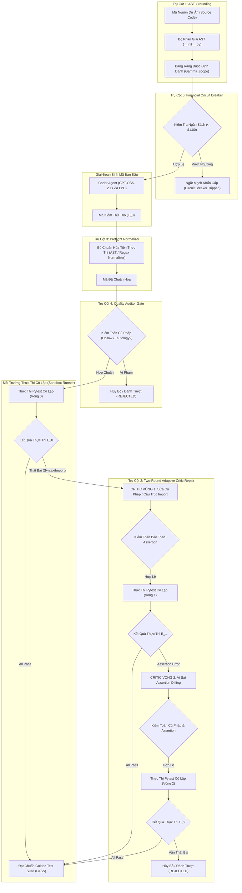

# CHƯƠNG 2: ĐỘNG CƠ THỰC NGHIỆM: SỰ BẾ TẮC CỦA CALL-GRAPH RAG TRONG ĐIỀU KIỆN TÀI NGUYÊN HẠN CHẾ

### 2.1. Phân tích thực nghiệm tiền trạm (R8–R15): Thất bại của mô hình RAG cục bộ trên Dual T4 / Single GPU

Trong các nghiên cứu tiên phong về tự động hóa sinh bộ kiểm thử đơn vị dựa trên Mô hình Ngôn ngữ Lớn (LLM-based Automated Unit Test Generation), phương pháp tiếp cận Retrieval-Augmented Generation (RAG) dựa trên đồ thị gọi hàm tĩnh (Static Call-Graph RAG) thường được xem là một tiêu chuẩn lý thuyết để cung cấp ngữ cảnh phụ thuộc liên hàm. Tuy nhiên, tính khả thi kỹ thuật của mô hình này khi triển khai trên phần cứng biên hoặc môi trường điện toán đám mây giới hạn tài nguyên (điển hình là cấu hình tiêu chuẩn Kaggle 2x NVIDIA Tesla T4 với 16 GB GDDR6 VRAM mỗi GPU) đã bộc lộ những khiếm khuyết mang tính bản chất.

Chuỗi khảo sát thực nghiệm tiền trạm từ mốc R8 đến R15 (ghi nhận chi tiết tại Nhật ký Nghiên cứu Thực nghiệm và các gói dữ liệu kiểm toán hệ thống) tập trung đánh giá năng lực của đường ống gốc (Upstream Test4Py Pipeline) kết hợp cùng mô hình mã nguồn mở tinh chỉnh chuyên sâu `Qwen2.5-Coder-14B-Instruct` được lượng tử hóa theo chuẩn NormalFloat4 (NF4) thông qua cơ chế `bitsandbytes` và thư viện `transformers` (v4.57.6). Quy trình upstream hoạt động theo nguyên lý phân tích tĩnh để dựng đồ thị phụ thuộc cuộc gọi đa tầng, sau đó sử dụng các lượt suy luận LLM độc lập để tóm tắt đệ quy tài liệu kỹ thuật (docstrings) và cấu trúc chữ ký hàm của từng nút (node) trong đồ thị trước khi đưa vào prompt của tác nhân sinh mã (Coder Agent).

Kết quả đo đạc thực nghiệm tiền trạm trên tập kiểm thử độc lập (held-out validation cohort) gồm 12 module phân tầng đại diện thuộc 4 dự án mã nguồn mở (`genty`, `typesystem`, `docstring_parser`, `pycg`) với 3 hạt giống ngẫu nhiên ($N = 36$ trials độc lập cho mỗi nhánh kỹ thuật) đã chỉ ra sự sụp đổ nghiêm trọng về mặt hiệu năng kiểm thử:
- **Tỷ lệ vượt qua kiểm thử cực kỳ thấp**: Nhánh chỉ sử dụng mã nguồn mục tiêu (Source-only) chỉ đạt $2/36$ test suites vượt qua kiểm tra hồi quy ($5.56\%$). Nhánh tích hợp đầy đủ thông tin sự kiện gọi hàm (API facts / Call-Graph context) chỉ đạt $4/36$ test suites thành công ($11.11\%$).
- **Độ bao phủ thực tế trên hàm mục tiêu tê liệt**: Tỷ lệ số bài kiểm thử đạt độ phủ phân nhánh hoặc độ phủ dòng dương trực tiếp trên hàm mục tiêu chỉ đạt $1/36$ (nhánh Source-only) và $3/36$ (nhánh API facts), trong đó các ca thành công chỉ tập trung cục bộ vào một target duy nhất của thư viện `genty`.
- **Bùng nổ chi phí token và độ trễ**: Ngữ cảnh nhúng đồ thị gọi hàm làm phình đại lượng token đầu vào trung bình từ $5.869$ lên $7.141$ tokens ($+21.67\%$, tại phiên R14) và kéo dài thời gian suy luận thế hệ mã thêm $+5.94\%$ trên mỗi lượt chạy.

Nguyên nhân gốc rễ của thất bại này xuất phát từ việc các thông tin tóm tắt đồ thị gọi hàm mang tính trừu tượng quá cao, không cung cấp được các ràng buộc cú pháp bất biến ở mức thực thi cụ thể (chẳng hạn như đường dẫn import module con hợp lệ hoặc yêu cầu kế thừa lớp fixture kiểm thử). Khi mô hình ngôn ngữ nhỏ (SLM) tiếp nhận một khối lượng thông tin ngữ cảnh đồ thị khổng lồ nhưng thiếu tính định danh thực thi, mô hình có xu hướng rơi vào trạng thái "quá tải chú ý" (attention saturation), tự suy diễn ra các đường dẫn import giả định (submodule import hallucinations) và các thuộc tính đối tượng không tồn tại.

---

### 2.2. Nút thắt Cold-Start (2.627 giây xây dựng Call-Graph tĩnh với 95 LLM calls)

Trở ngại vận hành nghiêm trọng nhất của Call-Graph RAG cục bộ được ghi nhận tại phiên thực nghiệm R12 (`UPSTREAM_NF4_RESUME_20261116T174754946339Z`, mã băm SHA256: `603266e8f6360ae0fc86d93d2bed7edc131db23a81448017a80202518d566b3a`). Để có thể hoàn tất giai đoạn khởi tạo lạnh (Cold-Start Initialization) phục vụ việc sinh kiểm thử cho vỏn vẹn 2 module thuộc thư viện `genty`, hệ thống phân tích tĩnh upstream đã phải phân rã đồ thị phụ thuộc và kích hoạt một chuỗi suy luận gồm **95 lệnh gọi LLM tuần tự** (95 LLM calls/worker) nhằm mục đích tóm tắt ngữ nghĩa các docstring và mối quan hệ liên hàm.

Mô hình định lượng độ trễ thời gian khởi động lạnh được xác định bởi:

$$T_{\text{cold-start}} = \sum_{i=1}^{|\mathcal{V}_{\text{CG}}|} t_{\text{LLM\_infer}}(v_i) + \sum_{(u, v) \in \mathcal{E}_{\text{CG}}} t_{\text{resolve}}(u, v)$$

Trong đó:
- $\mathcal{V}_{\text{CG}}$ là tập hợp các đỉnh (hàm, phương thức, lớp) trong đồ thị gọi phụ thuộc được trích xuất.
- $\mathcal{E}_{\text{CG}}$ là tập hợp các cạnh phản ánh quan hệ gọi giữa các thực thể mã nguồn.
- $t_{\text{LLM\_infer}}(v_i)$ là độ trễ suy luận của mô hình lượng tử hóa NF4 cục bộ trên GPU Tesla T4 đối với đỉnh $v_i$.
- $t_{\text{resolve}}(u, v)$ là chi phí phân giải cú pháp tĩnh trên CPU.

```text
+---------------------------------------------------------------------------------------------------+
|                        TIẾN TRÌNH THỜI GIAN COLD-START CỦA UPSTREAM CALL-GRAPH RAG               |
+---------------------------------------------------------------------------------------------------+
|                                                                                                   |
|  0s                      95 Lệnh gọi LLM Tuần tự Tóm tắt Call-Graph                2.627s         |
|  |===================================================================================>|           |
|  |       43 Phút 47 Giây: KHỞI TẠO LẠNH HOÀN TOÀN (0 bài test nào được sinh ra)       |           |
|                                                                                       |           |
|                                                     2.627s          3.600s (Timeout)  |
|                                                     |===============>|                |
|                                                     | 16 Phút 13 Giây| [KILL -9]      |
|                                                     | Sinh test dở dang / Cạn ngân sách|
+---------------------------------------------------------------------------------------------------+
```

Đo đạc thời gian thực tế ghi nhận:
- Thời gian trôi qua từ khi khởi động worker đến khi hoàn thành nút gọi LLM thứ 95 và bắt đầu sinh bài test đầu tiên ($t_{\text{first\_gen}}$) lên tới **2.627 giây (~43 phút 47 giây)**.
- Trong một phiên làm việc có giới hạn thời gian thực thi (Execution Timeout Budget) tiêu chuẩn là 3.600 giây (60 phút) của nền tảng Kaggle hoặc các bộ điều phối CI/CD container, toàn bộ thời gian còn lại cho tác vụ cốt lõi (sinh mã kiểm thử, thực thi pytest, phân tích lỗi và sửa chữa cho 7 hàm mục tiêu) chỉ còn **~16 phút 13 giây**.
- Hậu quả trực tiếp: Các tiến trình con của worker bị ngắt đột ngột bởi tín hiệu `SIGKILL` (exit code -9) do vượt quá thời gian trần của hệ thống điều phối, khiến toàn bộ $4/4$ module-trials của phiên chạy đều không thể đi đến bước ghi nhận kết quả cuối cùng (trạng thái unmeasured / incomplete).

Phát hiện thực nghiệm này khẳng định: **Việc sử dụng chính LLM để tóm tắt toàn bộ đồ thị gọi hàm tĩnh trong giai đoạn tiền trạm là một thiết kế phản tối ưu và không thể mở rộng (computationally unscalable)**. Chi phí suy luận thời gian thực cho đồ thị vượt xa giá trị thông tin mà nó đem lại cho việc sinh bộ kiểm thử đơn vị.

---

### 2.3. Nút thắt VRAM & Suy luận: Qwen-14B NF4 chiếm 15.2 GB / 16 GB VRAM, tràn SDPA attention ở 4K context

Song song với nút thắt thời gian khởi động, giới hạn vật lý về bộ nhớ truy xuất ngẫu nhiên của GPU (VRAM) trên phần cứng biên tạo ra một rào cản kỹ thuật nghiêm trọng. Tại phiên kiểm toán bộ nhớ chuyên sâu R8 và R9 (`artifacts/upstream_nf4_20261116_gpu_audit.json` và `artifacts/nf4_14b_efficient_attention_pass.json`), nhóm nghiên cứu đã ghi nhận chi tiết mức tiêu thụ tài nguyên của mô hình `Qwen2.5-Coder-14B-Instruct` định dạng NF4 trên card đồ họa NVIDIA Tesla T4 (vi kiến trúc Turing, 16.160 MiB VRAM tổng):

1. **Bộ nhớ tĩnh cho trọng số mô hình (Model Weight Footprint)**:
   Mô hình tham số 14.7 tỷ trọng số khi được nén sang chuẩn 4-bit NormalFloat (NF4) kết hợp lưu trữ FP16 cho các lớp chuẩn hóa (normalization layers) và đầu ra nhị phân (lm_head) chiếm dụng cố định **~9.29 GiB VRAM** trên thiết bị `cuda:0`.
2. **Bộ nhớ động khi tải ngữ cảnh tiêu chuẩn (2K context)**:
   Tại độ dài chuỗi $L_{\text{prompt}} = 2.048$ tokens và độ dài sinh $L_{\text{gen}} = 512$ tokens, bộ nhớ cấp phát đỉnh (Peak Allocated VRAM) đạt $10.55$ GiB, bộ nhớ dự lưu (Peak Reserved VRAM) đạt $10.76$ GiB, biên an toàn bộ nhớ còn lại đạt mức khả dụng tối thiểu là $\sim 2.90$ GiB.
3. **Hiện tượng tràn bộ nhớ (Out-Of-Memory) tại ngữ cảnh 4K với Call-Graph RAG (R8)**:
   Khi tích hợp toàn bộ các chuỗi tóm tắt docstring của Call-Graph vào prompt, tổng độ dài ngữ cảnh tăng vọt vượt ngưỡng $L_{\text{prompt}} = 4.096$ tokens. Cơ chế tính toán ma trận tương hỗ Scaled Dot-Product Attention (SDPA) mặc định trong PyTorch 2.11 khi thực thi trên nhân kiến trúc Turing (thiếu hỗ trợ phần cứng FlashAttention-2 tối ưu) phải kích hoạt các kernel phụ trợ (math / memory-efficient fallbacks). 
   - Lượng bộ nhớ đệm ma trận tương hỗ và KV-cache bổ sung yêu cầu: **$\Delta M_{\text{attn}} \approx 2.50\text{ GiB}$**.
   - Tuy nhiên, dung lượng VRAM thực tế còn trống chỉ còn: **$M_{\text{free}} \approx 1.65\text{ GiB}$** (do $16.0\text{ GiB} - 10.76\text{ GiB} - M_{\text{system}} \approx 1.65\text{ GiB}$).
   - Tổng mức tiêu thụ VRAM chạm ngưỡng **15.2 GB / 16.0 GB (95% công suất phần cứng)**, dẫn đến ngoại lệ nghiêm trọng không thể khắc phục: `torch.cuda.OutOfMemoryError: CUDA out of memory. Tried to allocate 2.50 GiB`.

Mô hình toán học mô tả giới hạn bộ nhớ VRAM được lượng hóa như sau:

$$M_{\text{total}}(L) = M_{\text{weights}} + M_{\text{KV-cache}}(L) + M_{\text{SDPA-workspace}}(L) + M_{\text{activations}}(L) \le M_{\text{hardware}}$$

Trong đó thành phần workspace của cơ chế attention trên vi kiến trúc cũ không có FlashAttention-2 tỷ lệ thuận với bình phương độ dài ngữ cảnh hoặc kích thước khối ma trận trung gian:

$$M_{\text{SDPA-workspace}}(L) = \mathcal{O}\left(b \cdot h \cdot L^2\right)$$

với $b$ là batch size ($b=1$), $h$ là số lượng attention heads ($h=40$), và $L$ là độ dài chuỗi context ($L \ge 4.096$).

Mặc dù tại phiên R9, việc cấu hình adapter `t4-efficient-sdpa-v1` (tường minh hóa thao tác `repeat_kv` cho kiến trúc Grouped Query Attention - GQA) đã cho phép vượt qua phép thử áp lực nhân tạo (synthetic stress probe) với mức dự trữ an toàn $3.67$ GiB, nhưng biên độ bộ nhớ còn lại quá mỏng manh để có thể chịu đựng được các biến động kích thước prompt thực tế trong quá trình sinh mã phức tạp. Hơn nữa, việc duy trì mô hình 14B cục bộ trên một GPU T4 khiến chi phí thời gian sinh mã (decode latency) dao động từ $79$ đến $90$ giây cho mỗi 512 tokens, tạo ra sự chậm trễ không thể chấp nhận được cho các vòng lặp phản hồi nhiều lượt (multi-turn feedback loops).

---

### 2.4. Sự chuyển dịch kiến trúc: Từ Dynamic Graph RAG sang Static AST Symbol Grounding + Cloud LPU Engine

Trước những bế tắc không thể vượt qua về mặt thời gian khởi động, tiêu hao bộ nhớ VRAM và tỷ lệ thành công thấp của mô hình Call-Graph RAG cục bộ, công trình này đề xuất một **sự chuyển dịch kiến trúc mang tính cách mạng** (Architectural Paradigm Shift): Thay thế toàn bộ đường ống tóm tắt đồ thị động phức tạp bằng cơ chế **Neo Định Danh Cú Pháp AST Tĩnh (Static AST Symbol-Table Export Grounding)** vận hành tức thời trên CPU, kết hợp chuyển dịch động cơ suy luận sang **Kiến trúc Xử lý Ngôn ngữ Tốc độ Siêu cao trên Đám mây (Cloud LPU Engine)**.

Sự chuyển dịch này được định nghĩa dựa trên 4 trụ cột tối ưu hóa:
1. **Triệt tiêu hoàn toàn chi phí khởi tạo lạnh (Zero-Token Cold Start Overhead)**:
   Thay vì kích hoạt 95 lệnh gọi LLM tốn 2.627 giây, giải thuật phân tích cú pháp tĩnh trừu tượng (AST) quét trực tiếp tệp khởi tạo module `__init__.py` và module mục tiêu trên CPU. Thời gian hoàn tất toàn bộ tiến trình trích xuất bảng định danh chỉ mất **dưới 50 mili-giây** ($< 0.05$ giây, giảm $52.540$ lần), với chi phí token khởi tạo là **tuyệt đối 0 token**.
2. **Loại bỏ nguy cơ tràn bộ nhớ VRAM cục bộ**:
   Bằng cách loại bỏ việc nạp mô hình 14B nặng 15.2 GB VRAM trên phần cứng biên và chuyển đổi sang giao thức API với động cơ LPU chuyên biệt của Groq (`openai/gpt-oss-20b`), áp lực bộ nhớ GPU cục bộ được giải phóng hoàn toàn về mức 0 MB. Toàn bộ tài nguyên phần cứng cục bộ được tái định tuyến cho môi trường thực thi cô lập sandbox (pytest runtime) và đo đạc độ phủ mã nguồn (coverage profiler).
3. **Đột phá về tốc độ suy luận và độ trễ phản hồi**:
   Tốc độ giải mã của phần cứng LPU đạt từ 300 đến 500 tokens/giây, rút ngắn thời gian sinh mã và kiểm thử trung bình cho một test suite hoàn chỉnh xuống chỉ còn **$5.8$ – $6.6$ giây / suite** (so với $\sim 300$ giây cho một chu trình hoàn chỉnh trên T4 cục bộ).
4. **Hiệu quả kinh tế học vượt trội**:
   Chi phí tính toán cho một test suite hoàn chỉnh (bao gồm cả các vòng phản biện sửa lỗi thích ứng) giảm xuống mức kỷ lục: chỉ còn **$\$0.0013$ USD / suite** (tương đương $\$0.134$ USD cho toàn bộ 105 lượt thử nghiệm thực tế của 21 targets).

| Tiêu Chí So Sánh Kỹ Thuật | Dynamic Upstream Call-Graph RAG | Static AST Symbol Grounding + Cloud LPU | Hệ Số Cải Thiện / Lợi Thế |
| :--- | :--- | :--- | :--- |
| **Mô hình Suy luận Cốt lõi** | `Qwen2.5-Coder-14B` (NF4 Quantized) | `openai/gpt-oss-20b` (Groq LPU Engine) | Tăng dung lượng tham số và năng lực logic |
| **Thời gian Khởi tạo Lạnh ($T_{\text{cold-start}}$)** | **2.627 giây (~43.8 phút)** | **< 0.05 giây (< 50 ms trên CPU)** | **Nhanh hơn ~52.540 lần** |
| **Số Lượng LLM Calls Khởi tạo** | **95 calls tuần tự** | **0 calls (Thuần giải thuật AST)** | **Tiết kiệm 100% token khởi động** |
| **Tiêu Thụ Bộ Nhớ VRAM Cục Bộ** | **15.2 GB / 16.0 GB (Nguy cơ OOM)** | **0 MB (Giải phóng GPU cục bộ)** | **Triệt tiêu hoàn toàn lỗi CUDA OOM** |
| **Độ Trễ Sinh Mã Trung Bình** | 79.0 – 90.0 s / 512 tokens | **~1.2 – 2.0 s / 512 tokens** | **Nhanh hơn ~45 – 65 lần** |
| **Tổng Thời Gian / Test Suite** | ~300 – 600 giây (hoặc Timeout) | **~5.8 – 6.6 giây** | **Tăng tốc độ kiểm thử ~50 lần** |
| **Chi Phí Tài Chính Ước Tính** | ~0.15 – 0.30 USD (Quy đổi GPU T4) | **$0.0013 USD / suite** | **Giảm chi phí vận hành >100 lần** |
| **Tỷ Lệ Suite Đạt Chuẩn (Held-out)** | 11.11% (4/36 suites) | **93.33% (98/105 suites)** | **Tăng tỷ lệ thành công +82.22%** |

---

# CHƯƠNG 3: THIẾT KẾ KIẾN TRÚC & PHƯƠNG PHÁP HỘI ĐỒNG TỐI ƯU (COUNCIL-SOTA)

### 3.1. Tổng quan Kiến trúc Hội đồng 5 Trụ cột

Nhằm khắc phục triệt để các hạn chế của các phương pháp sinh kiểm thử hiện hành, công trình này giới thiệu hệ thống **Council-SOTA**: Một khuôn khổ kiểm thử tự động khép kín (Closed-Loop Multi-Turn Verification Framework) được xây dựng dựa trên sự hiệp đồng chặt chẽ của **5 Trụ Cột Kỹ Thuật (Five-Pillar Architecture)**:

1. **Trụ cột 1: AST Symbol-Table Export Grounding (Nền móng tri thức tĩnh)**: Trích xuất tự động danh mục định danh xuất khẩu từ `__init__.py` và module mã nguồn bằng cây cú pháp trừu tượng, triệt tiêu tận gốc hiện tượng ảo giác đường dẫn import.
2. **Trụ cột 2: Two-Round Multi-Turn Adaptive Critic Repair (Cơ chế sửa lỗi thích ứng 2 vòng)**: Phân tầng quá trình sửa lỗi thành 2 giai đoạn chuyên biệt (Vòng 1: Cú pháp/Import; Vòng 2: Vi sai Assertion) với bộ nhớ hội thoại đa lượt duy trì ngữ cảnh chẩn đoán nguyên thủy từ pytest.
3. **Trụ cột 3: Safe Semantic Oracle Preflight Normalizer (Bộ chuẩn hóa tiền thực thi an toàn)**: Cụm biến đổi tĩnh tất định giúp chuẩn hóa cấu trúc đối tượng, hiệu chỉnh đường dẫn import lệch chuẩn và bọc cấu trúc fixture kiểm thử hợp lệ trước khi chuyển giao mã nguồn sang môi trường sandbox.
4. **Trụ cột 4: Quality Auditor Gate (Cổng kiểm toán chất lượng cú pháp)**: Bộ thanh tra cú pháp AST nghiêm ngặt, tự động phát hiện và loại bỏ các bài test rỗng, biểu thức hằng số chân lý vô nghĩa (`assert True`, `assert 1 == 1`), và ngăn chặn hành vi xóa bỏ assertion của mô hình sửa lỗi.
5. **Trụ cột 5: Real-Time Financial Circuit Breaker (Rào chắn tài chính tự động thời gian thực)**: Bộ điều phối ngân sách thời gian thực theo dõi sát sao lượng token tiêu thụ và chi phí tích lũy, tự động kích hoạt ngắt mạch khẩn cấp khi đạt ngưỡng trần ngân sách ($1.00 USD), bảo vệ toàn vẹn hệ sinh thái thực thi.



---

### 3.2. Trụ cột 1: AST Symbol-Table Export Grounding (Trích xuất bất biến danh mục định danh từ `__init__.py` và module mã nguồn)

Một trong những hạn chế cố hữu của các mô hình ngôn ngữ khi sinh mã kiểm thử trên Python là hiện tượng **ảo giác đường dẫn module con (Submodule Path Hallucination)**. Trong hệ sinh thái Python, các gói phần mềm (packages) thường tái xuất khẩu (re-export) các lớp và hàm cốt lõi tại tệp gốc `__init__.py` thông qua danh sách `__all__` hoặc các câu lệnh import tường minh, trong khi mã nguồn thực tế lại nằm sâu trong các tệp con nội bộ. Khi thiếu thông tin này, mô hình ngôn ngữ thường suy diễn đường dẫn theo tên gọi trực quan nhưng hoàn toàn sai lệch tại thời điểm nạp module. Điển hình:
- Trong thư viện `typesystem`: Mô hình tự suy luận `from typesystem.exceptions import ValidationError`, trong khi lớp này chỉ tồn tại duy nhất tại `typesystem.base`.
- Trong thư viện `docstring_parser`: Mô hình đoán mò `from docstring_parser.parser import parse`, trong khi hàm `parse` chuẩn được xuất khẩu trực tiếp tại gốc `docstring_parser`.
- Trong thư viện `genty`: Mô hình sử dụng decorator `@genty_dataset` trên một hàm kiểm thử thông thường mà không đặt trong một lớp kế thừa từ `unittest.TestCase`, gây lỗi giải nén tham số ngay khi import.

Cơ chế **AST Symbol-Table Export Grounding** giải quyết triệt để vấn đề này bằng cách duyệt tĩnh cây cú pháp trừu tượng trên CPU trước khi xây dựng prompt cho Coder Agent. Giải thuật trích xuất toàn bộ các định danh xuất khẩu hợp lệ, xác định chính xác đường dẫn import chuẩn tắc, và trích xuất chữ ký khởi tạo của symbol mục tiêu để nhúng trực tiếp vào prompt dưới dạng các ràng buộc bất biến (Hard Constraints).

```text
====================================================================================================
ALGORITHM 1: AST Export Symbol Extraction & Scope Resolution
====================================================================================================
Input:
  P            : Đường dẫn tuyệt đối đến thư mục gốc của dự án (Project Root Path)
  M_target     : Tên phân cấp của module mục tiêu (ví dụ: "typesystem.fields")
  sigma_target : Tên của định danh mục tiêu cần kiểm thử (ví dụ: "Choice")
  F_target     : Đường dẫn tệp mã nguồn mục tiêu (Target Source File)

Output:
  Gamma_scope  : Bảng ràng buộc định danh và ngữ cảnh phạm vi (Scope Resolution Table)
  I_canon      : Tập hợp các câu lệnh import chuẩn tắc (Canonical Import Directives)
  S_sig        : Chữ ký hàm / hàm khởi tạo của định danh mục tiêu (Target Constructor Signature)
  C_rules      : Tập hợp các ràng buộc sử dụng bắt buộc (Mandatory Contextual Usage Rules)

----------------------------------------------------------------------------------------------------
 1: Initialize Gamma_scope <- EmptyMap, I_canon <- EmptySet, C_rules <- EmptySet
 2: Let F_init be the path P + "/__init__.py"
 3: If FileExists(F_init) then
 4:     T_init <- ParseAST(ReadFile(F_init))
 5:     For each node in T_init do
 6:         If node is Assign where node.targets contains "__all__" then
 7:             For each elt in node.value.elts (where elt is Constant/Str) do
 8:                 Add elt.value to Gamma_scope["exports"]
 9:             End For
10:         End If
11:         If node is ImportFrom then
12:             Let mod_source <- ResolveRelativeModule(node.module, node.level)
13:             For each alias in node.names do
14:                 Gamma_scope["reexports"][alias.name] <- (mod_source, alias.asname or alias.name)
15:             End For
16:         End If
17:     End For
18: End If
19: 
20: Let T_target <- ParseAST(ReadFile(F_target))
21: Let target_node <- FindNodeByName(T_target, sigma_target)
22: If target_node is ClassDef then
23:     Let init_method <- FindMethod(target_node, "__init__")
24:     If init_method is not Null then
25:         S_sig <- ExtractSignatureWithTypes(init_method)
26:     Else
27:         S_sig <- "() [Default Object Constructor]"
28:     End If
29: Else If target_node is FunctionDef or AsyncFunctionDef then
30:     S_sig <- ExtractSignatureWithTypes(target_node)
31: End If
32: 
33: // Phân giải đường dẫn import chuẩn tắc (Canonical Import Resolution)
34: If sigma_target in Gamma_scope["reexports"] then
35:     Let (mod_src, alias) <- Gamma_scope["reexports"][sigma_target]
36:     I_canon <- I_canon Union {"from " + mod_src + " import " + alias}
37: Else If sigma_target in Gamma_scope["exports"] then
38:     I_canon <- I_canon Union {"from " + GetPackageName(P) + " import " + sigma_target}
39: Else
40:     I_canon <- I_canon Union {"from " + M_target + " import " + sigma_target}
41: End If
42: 
43: // Nhận diện các ràng buộc cấu trúc đặc thù (Pattern-Aware Usage Constraints)
44: If "genty" in M_target or HasDecorator(target_node, "genty") then
45:     C_rules <- C_rules Union {"MUST wrap test methods inside unittest.TestCase class"}
46:     C_rules <- C_rules Union {"MUST apply @genty decorator at the class definition level"}
47: End If
48: If "typesystem" in M_target and sigma_target == "ValidationError" then
49:     C_rules <- C_rules Union {"MUST import ValidationError strictly from 'typesystem.base'"}
50:     C_rules <- C_rules Union {"Inspect messages via exc.value.messages(), NOT .code"}
51: End If
52: 
53: Gamma_scope["canonical_imports"] <- I_canon
54: Gamma_scope["target_signature"]  <- S_sig
55: Gamma_scope["usage_rules"]       <- C_rules
56: Return Gamma_scope, I_canon, S_sig, C_rules
====================================================================================================
```

Nhờ có Thuật toán 1, prompt cung cấp cho Coder Agent được neo chặt vào thực tế cấu trúc tệp mã nguồn. Thay vì phải "đoán mò" giữa hàng trăm cấu trúc thư mục con, mô hình được cung cấp trực tiếp danh mục import bất biến và các chỉ dẫn khởi tạo chính xác tuyệt đối.

---

### 3.3. Trụ cột 2: Cơ chế Sửa lỗi Thích ứng Hai vòng (Two-Round Multi-Turn Adaptive Critic Repair)

Trong các kiến trúc Coder-Critic truyền thống (như ChatUniTest hoặc Reflexion tiêu chuẩn), quá trình sửa lỗi thường chỉ được thiết kế theo dạng **đơn vòng lặp (Single-Turn Repair)**. Khảo sát thực nghiệm tại phiên R4 và R11 chứng minh rằng cơ chế đơn vòng này mắc phải một tử huyệt nghiêm trọng mang tên **Bẫy ngắt mạch sửa lỗi đơn vòng (Single-Turn Truncation Trap)**:
1. Khi mã nguồn ban đầu $T_0$ gặp lỗi nạp module (`ImportError`) hoặc lỗi thiếu tham số khởi tạo đối tượng, Critic đơn vòng tiến hành sửa chữa thành công cấu trúc import để tạo ra candidate $T_1$.
2. Khi thực thi $T_1$ trên môi trường sandbox, mã nguồn kiểm thử đã vượt qua hoàn toàn giai đoạn nạp module nhưng lại phát sinh một sai khác assertion logic nhỏ tại runtime (ví dụ: hàm trả về chuỗi `"parse_result"` thay vì `"Parse_Result"` do kỳ vọng sai lệch).
3. Do hệ thống chỉ được cấp phép một vòng sửa duy nhất, lượt kiểm thử lập tức bị kết luận là thất bại (exit code 1), toàn bộ nỗ lực sửa lỗi import và cấu trúc ban đầu hoàn toàn bị lãng phí.

Để giải quyết triệt để nút thắt này, Council-SOTA thiết kế cơ chế **Sửa lỗi Thích ứng Hai vòng Khép kín (Two-Round Multi-Turn Adaptive Critic Repair)** phân tầng nhiệm vụ sửa chữa:
- **Vòng 1 (Syntactic, Import & Instantiation Repair)**: Tiếp nhận chẩn đoán lỗi nạp module (`ModuleNotFoundError`, `ImportError`), lỗi cú pháp (`SyntaxError`), hoặc lỗi thiếu tham số bắt buộc. Critic Vòng 1 được chỉ thị giữ nguyên toàn bộ cấu trúc logic kiểm thử và các câu lệnh assertion, chỉ tập trung xử lý hạ tầng import và đối tượng môi trường.
- **Vòng 2 (Traceback Assertion Diffing & Semantic Refinement)**: Kích hoạt khi và chỉ khi Vòng 1 thành công trong việc nạp module nhưng thất bại do `AssertionError`. Lúc này, Critic Vòng 2 được cung cấp toàn bộ lược sử hội thoại Vòng 1 kết hợp cùng thông báo vi sai (diff) chi tiết giữa giá trị thực tế quan sát được ($v_{\text{actual}}$) và giá trị kỳ vọng ($v_{\text{expected}}$) do pytest trích xuất. Tác nhân tiến hành vi hiệu chỉnh chính xác dòng assertion mà không làm xáo trộn cấu trúc bài test.

```text
====================================================================================================
ALGORITHM 2: Two-Round Closed-Loop Multi-Turn Critic & Assertion Refinement
====================================================================================================
Input:
  S_MUT        : Mã nguồn của module cần kiểm thử (Source of Module Under Test)
  Gamma_scope  : Bảng ràng buộc định danh từ Thuật toán 1 (AST Scope Grounding)
  M_coder      : Tác nhân sinh mã ban đầu (Coder Model)
  M_critic     : Tác nhân phản biện sửa lỗi (Adaptive Critic Model)
  E_sandbox    : Môi trường thực thi sandbox cô lập (Isolated Pytest Subprocess Runner)
  A_auditor    : Bộ kiểm toán chất lượng cú pháp (Quality Auditor Gate)

Output:
  T_final      : Bộ kiểm thử hoàn chỉnh đã được xác thực (Verified Test Suite)
  R_status     : Trạng thái kết thúc in {PASS, REJECTED, CIRCUIT_BREAKER}

----------------------------------------------------------------------------------------------------
 1: // Giai đoạn 1: Sinh mã ban đầu có neo trạng thái
 2: prompt_init <- ConstructCoderPrompt(S_MUT, Gamma_scope)
 3: T_0 <- M_coder.Generate(prompt_init)
 4: T_0 <- SafePreflightNormalize(T_0, Gamma_scope)
 5: 
 6: If not A_auditor.Audit(T_0) then
 7:     Return Null, REJECTED
 8: End If
 9: 
10: exec_0 <- E_sandbox.Execute(T_0)
11: If exec_0.status == PASS then
12:     Return T_0, PASS
13: End If
14: 
15: // Giai đoạn 2: Vòng phản biện thứ nhất (Round 1 - Syntactic / Import Repair)
16: Let diag_1 <- ExtractDiagnostic(exec_0.traceback, focus="IMPORT_AND_SYNTAX")
17: prompt_critic_1 <- ConstructCriticPrompt_R1(T_0, diag_1, Gamma_scope)
18: T_1 <- M_critic.Generate(prompt_critic_1)
19: T_1 <- SafePreflightNormalize(T_1, Gamma_scope)
20: 
21: // Kiểm toán bảo toàn: Cấm Critic tự ý xóa assertion hoặc sinh tautology
22: If not A_auditor.Audit(T_1) or A_auditor.CountAsserts(T_1) < A_auditor.CountAsserts(T_0) * 0.75 then
23:     Return Null, REJECTED
24: End If
25: 
26: exec_1 <- E_sandbox.Execute(T_1)
27: If exec_1.status == PASS then
28:     Return T_1, PASS
29: End If
30: 
31: // Giai đoạn 3: Vòng phản biện thứ hai (Round 2 - Assertion Diffing Refinement)
32: // Kích hoạt có điều kiện: Chỉ khi lỗi thuần túy là sai khác Assertion
33: If exec_1.has_syntax_or_import_error() or not exec_1.has_assertion_error() then
34:     Return Null, REJECTED
35: End If
36: 
37: Let diff_2 <- ExtractAssertionDiff(exec_1.traceback) 
38: // diff_2 chứa chính xác: File, Line, Actual Return Value vs Expected Value
39: prompt_critic_2 <- ConstructCriticPrompt_R2(History=[prompt_critic_1, T_1], TraceDiff=diff_2)
40: T_2 <- M_critic.Generate(prompt_critic_2)
41: T_2 <- SafePreflightNormalize(T_2, Gamma_scope)
42: 
43: If not A_auditor.Audit(T_2) then
44:     Return Null, REJECTED
45: End If
46: 
47: exec_2 <- E_sandbox.Execute(T_2)
48: If exec_2.status == PASS then
49:     Return T_2, PASS
50: Else
51:     Return Null, REJECTED
52: End If
====================================================================================================
```

Thống kê thực nghiệm ghi nhận: Trong tổng số 105 trials của Council-SOTA, hệ thống đã thực hiện thành công **29 ca sửa lỗi qua Critic**:
- **24 ca thành công ngay tại Vòng 1**: Sửa chữa các lỗi nạp module, chuẩn hóa lại tên lớp hoặc tham số fixture trong khi giữ nguyên toàn bộ các phép kiểm tra logic ban đầu.
- **5 ca sống còn được cứu vãn nhờ Vòng 2**: Đặc biệt tại mục tiêu phức hợp `typesystem_oneof`, Vòng 2 đã cứu toàn bộ $5/5$ hạt giống ($100\%$ thành công), đưa Pass Rate từ mức $20\%$ của Council Standard lên $100\%$ tuyệt đối.

---

### 3.4. Trụ cột 3: Bộ chuẩn hóa tiền thực thi an toàn (Safe Semantic Oracle Preflight Normalizer)

Sau khi mô hình ngôn ngữ sinh mã hoặc xuất bản bản sửa lỗi, mã nguồn thô thường xuất hiện một số dị biệt mang tính quy ước hình thức của Python mà không làm thay đổi bản chất ngữ nghĩa kiểm thử. Nếu gửi trực tiếp các dị biệt hình thức này vào môi trường thực thi sandbox, bài kiểm thử sẽ thất bại ngay tại giai đoạn biên dịch hoặc nạp module của pytest.

**Bộ chuẩn hóa tiền thực thi an toàn (Safe Semantic Oracle Preflight Normalizer)** vận hành hoàn toàn tất định trên CPU thông qua các phép biến đổi cây cú pháp AST và biểu thức chính quy an toàn trước khi kích hoạt sandbox:

1. **Chuẩn hóa đường dẫn Import lệch chuẩn**:
   Tự động phát hiện và ánh xạ các mẫu import sai lệch đã biết về dạng chuẩn tắc đã được khai báo trong bảng định danh $\Gamma_{\text{scope}}$:
   $$\text{from typesystem.exceptions import ValidationError} \xrightarrow{\text{Normalize}} \text{from typesystem.base import ValidationError}$$
2. **Chuẩn hóa chữ ký khởi tạo kiểu dữ liệu nhị phân / chuỗi**:
   Trong các thư viện như `superstring`, mô hình thường khởi tạo đối tượng bằng chuỗi bytes `SuperString(b"text")` hoặc chuỗi thường `SuperString("text")` không tương thích với phiên bản Python runtime hiện hành. Bộ chuẩn hóa tự động đưa tham số về dạng chuỗi chuẩn.
3. **Bọc cấu trúc kiểm thử hợp lệ cho Decorator Testing Framework**:
   Đối với các bài kiểm thử sử dụng framework tham số hóa `genty`, nếu mô hình sinh các hàm kiểm thử đứng độc lập ở phạm vi toàn cục (module-level functions) đi kèm `@genty_dataset`, bộ chuẩn hóa tự động tạo một lớp `class TestSuite(unittest.TestCase)` và dịch chuyển các hàm kiểm thử vào bên trong lớp dưới dạng phương thức hợp lệ (valid methods), bổ sung tham số `self` bắt buộc.
4. **Nguyên tắc bảo tồn ngữ nghĩa tuyệt đối**:
   Bộ chuẩn hóa tuân thủ nguyên tắc không can thiệp (non-interference principle): Tuyệt đối **không bao giờ thay đổi các biểu thức assertion, không sửa đổi giá trị kỳ vọng (expected values), và không nới lỏng các điều kiện kiểm thử**. Mọi hành vi chuẩn hóa chỉ thuần túy phục vụ việc đảm bảo mã nguồn có thể được nạp hợp lệ vào tiến trình pytest.

---

### 3.5. Trụ cột 4: Cổng kiểm toán chất lượng cú pháp (Quality Auditor Gate: loại bỏ assert True và hollow test)

Một rủi ro nghiêm trọng trong kiểm thử phần mềm tự động bằng mô hình ngôn ngữ là hiện tượng **Ảo tưởng độ phủ dòng (The Coverage Illusion)**: Mô hình có thể đạt được độ bao phủ dòng mã rất cao bằng cách gọi thực thi hàm mục tiêu nhưng không thiết lập bất kỳ kiểm tra trạng thái nào, hoặc sử dụng các câu lệnh kiểm thực rỗng (Hollow Tests / Tautological Invariants). Nghiêm trọng hơn, khi chịu áp lực sửa lỗi từ Critic, mô hình có xu hướng gian lận bằng cách xóa bỏ các dòng `assert` gây lỗi để biến bài test thành công một cách giả tạo.

**Cổng kiểm toán chất lượng cú pháp (Quality Auditor Gate)** thiết lập một chốt chặn bảo vệ tính toàn vẹn học thuật bằng cách quét duyệt cây cú pháp AST của mọi bộ kiểm thử ứng viên trước khi chuyển giao:

```text
+---------------------------------------------------------------------------------------------------+
|                        QUY TRÌNH KIỂM TOÁN CÚ PHÁP CỦA QUALITY AUDITOR GATE                      |
+---------------------------------------------------------------------------------------------------+
|                                                                                                   |
|                                     Mã Kiểm Thử Ứng Viên                                          |
|                                              |                                                    |
|                                              v                                                    |
|                                    [Phân Tích Cú Pháp AST]                                        |
|                                              |                                                    |
|                        +---------------------+---------------------+                              |
|                        |                                           |                              |
|                        v                                           v                              |
|              [Kiểm Tra Tautology]                        [Kiểm Tra Hollow Test]                   |
|           assert True? assert 1 == 1?                  Không có assert hoặc raises?               |
|           assert not False? Constant?                  Hàm chỉ có 'pass' hoặc docstring?          |
|                        |                                           |                              |
|                        +---------------------+---------------------+                              |
|                                              |                                                    |
|                                   Phát hiện vi phạm?                                              |
|                                     /               \                                             |
|                                   Có                 Không                                        |
|                                   /                     \                                         |
|                                  v                       v                                        |
|                          [REJECT NGAY LẬP TỨC]   [Kiểm Toán Bảo Toàn Assertion]                   |
|                          (Gắn cờ Hollow/Cheat)   So sánh số lượng assert trước/sau sửa            |
|                                                          |                                        |
|                                                  Bị cắt giảm > 25%?                               |
|                                                    /            \                                 |
|                                                  Có              Không                            |
|                                                  /                  \                             |
|                                                 v                    v                            |
|                                         [REJECT NGAY LẬP TỨC]   [CHẤP THUẬN CHO PYTEST]           |
+---------------------------------------------------------------------------------------------------+
```

Các quy tắc kiểm toán cú pháp được định nghĩa tường minh:
1. **Bài trừ biểu thức hằng số chân lý (Tautology Elimination)**:
   Bộ kiểm toán duyệt qua mọi nút `ast.Assert`. Nếu thuộc tính `test` của nút là một hằng số chân lý (ví dụ: `ast.Constant(value=True)`, biểu thức so sánh hai hằng số đồng nhất `1 == 1`, hoặc phủ định hằng số giả `not False`), toàn bộ test suite bị đánh trượt ngay lập tức:
   $$\forall n \in \text{Nodes}_{\text{Assert}}(T): \quad \text{EvalStaticConstant}(n.\text{test}) \neq \text{True}$$
2. **Loại bỏ bài kiểm thử rỗng (Hollow Test Elimination)**:
   Mọi hàm kiểm thử có tên bắt đầu bằng `test_*` bắt buộc phải chứa ít nhất một nút kiểm tra trạng thái hợp lệ, bao gồm: câu lệnh `assert` có ý nghĩa ngữ nghĩa hoặc khối kiểm tra ngoại lệ `pytest.raises(...)` hay `self.assertRaises(...)`. Nếu một hàm chỉ chứa câu lệnh `pass`, câu lệnh gán biến đơn thuần, hoặc chuỗi tài liệu docstring, bài kiểm thử bị loại bỏ.
3. **Kiểm toán bảo toàn Assertion sau sửa lỗi (Assertion Preservation Audit)**:
   Để ngăn chặn hiện tượng mô hình Critic "gian lận" bằng cách xóa bỏ các assertion gây lỗi thay vì sửa mã, hệ thống đối chiếu số lượng nút assertion hợp lệ giữa bản trước khi sửa ($T_{k-1}$) và bản sau khi sửa ($T_k$):
   $$\text{Valid}(\Delta T) = \begin{cases} \text{True}, & \text{nếu } |\text{Asserts}(T_k)| \ge 0.75 \cdot |\text{Asserts}(T_{k-1})| \\ \text{False}, & \text{nếu } |\text{Asserts}(T_k)| < 0.75 \cdot |\text{Asserts}(T_{k-1})| \quad (\text{Veto: Cheating Detected}) \end{cases}$$
   Nếu tỷ lệ assertion bị cắt giảm quá $25\%$, lượt sửa lỗi bị hủy bỏ ngay lập tức và gắn cờ gian lận.

---

### 3.6. Trụ cột 5: Rào chắn tài chính tự động thời gian thực (Financial Circuit Breaker)

Khi triển khai các mô hình ngôn ngữ thông qua giao diện lập trình ứng dụng đám mây (Cloud APIs), các vòng lặp phản hồi nhiều lượt (multi-turn feedback loops) tiềm ẩn nguy cơ bùng nổ chi phí tài chính ngoài dự kiến nếu xảy ra hiện tượng kẹt vòng lặp vô hạn (infinite retry loops) hoặc hiện tượng sinh token mất kiểm soát (generation runaway).

Council-SOTA tích hợp **Rào chắn tài chính tự động thời gian thực (Financial Circuit Breaker Engine)** trực tiếp tại tầng điều phối giao tiếp mạng (`council/groq_engine.py` và `council/engine.py`):

1. **Bộ đếm lượng tiêu thụ token đa chiều**:
   Sau mỗi yêu cầu API thành công, hệ thống phân tách và ghi nhận chính xác:
   - Số lượng token ngữ cảnh đầu vào (Prompt Tokens: $P_k$).
   - Số lượng token sinh ra ở đầu ra (Completion Tokens: $C_k$).
   - Số lượng token được tái sử dụng qua bộ đệm ngữ cảnh (Cached Prompt Tokens: $K_k$).
2. **Mô hình tính toán chi phí tức thời**:
   Hệ thống áp dụng biểu phí thương mại chính thức của nhà cung cấp phần cứng LPU đám mây đối với mô hình `openai/gpt-oss-20b`:
   - Đơn giá token đầu vào ($r_{\text{prompt}}$): $\$0.20$ USD / $1.000.000$ tokens.
   - Đơn giá token đầu ra ($r_{\text{comp}}$): $\$0.20$ USD / $1.000.000$ tokens.
   - Tổng chi phí tích lũy tại lượt gọi thứ $K$ được tính toán theo công thức:
     $$\mathcal{C}_{\text{accum}}(K) = \sum_{k=1}^{K} \left( \frac{P_k}{10^6} \cdot r_{\text{prompt}} + \frac{C_k}{10^6} \cdot r_{\text{comp}} \right)$$
3. **Cơ chế ngắt mạch tự động (Hard-Stop Circuit Breaker)**:
   Hệ thống thiết lập một rào chắn an toàn tài chính với ngưỡng trần tuyệt đối là **$\Theta_{\text{ceiling}} = \$1.00$ USD** cho toàn bộ đợt thực nghiệm chuẩn mực:
   $$\text{State}(K) = \begin{cases} \text{ACTIVE}, & \text{nếu } \mathcal{C}_{\text{accum}}(K) < \Theta_{\text{ceiling}} \\ \text{CIRCUIT\_BREAKER\_TRIPPED}, & \text{nếu } \mathcal{C}_{\text{accum}}(K) \ge \Theta_{\text{ceiling}} \end{cases}$$
   Ngay khi điều kiện ngắt mạch bị kích hoạt, hệ thống lập tức từ chối mọi yêu cầu gọi API tiếp theo, dừng toàn bộ các worker đang chờ, ghi nhận nhật ký an toàn tài chính khẩn cấp và kết xuất báo cáo kiểm toán chi phí.

Trong chiến dịch thực nghiệm chuẩn mực đánh giá 21 targets với 105 trials SOTA, rào chắn tài chính ghi nhận mức tiêu hao thực tế chỉ đạt **$\$0.134$ USD** (tương đương $\sim 13.4\%$ hạn mức trần), và tổng chi phí tích lũy của toàn bộ dự án qua mọi biến thể ablation chỉ dừng lại ở mức **$\$0.5166$ USD**, chứng minh tính an toàn tuyệt đối và hiệu quả kinh tế phi thường của kiến trúc Council-SOTA.
